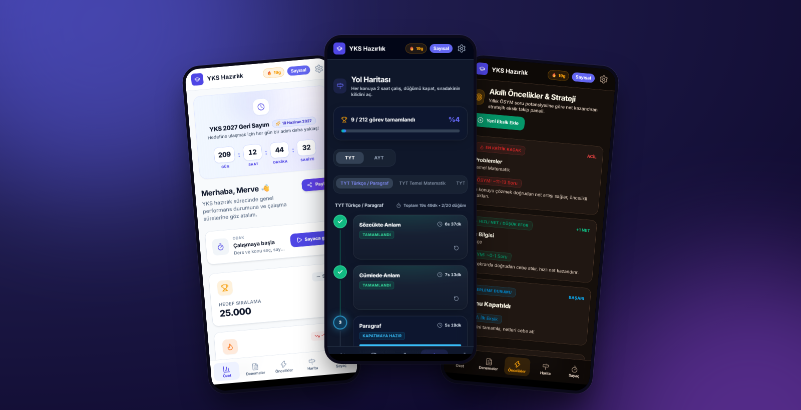
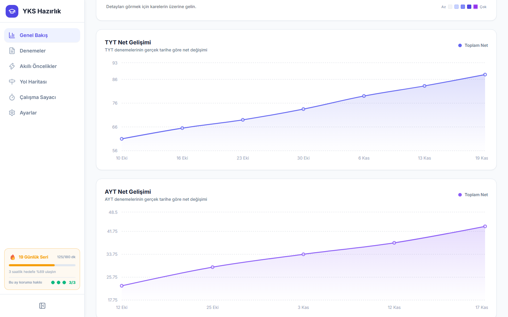
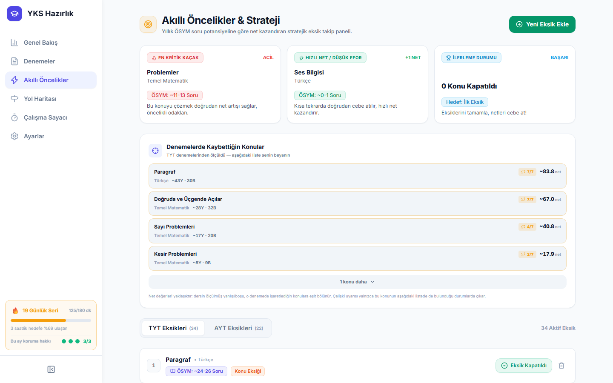
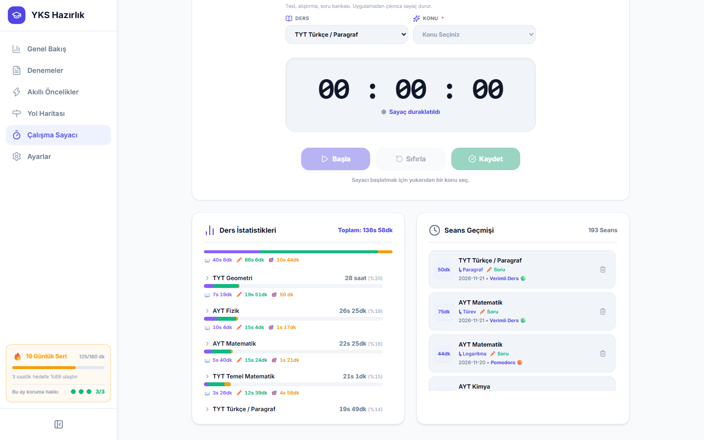
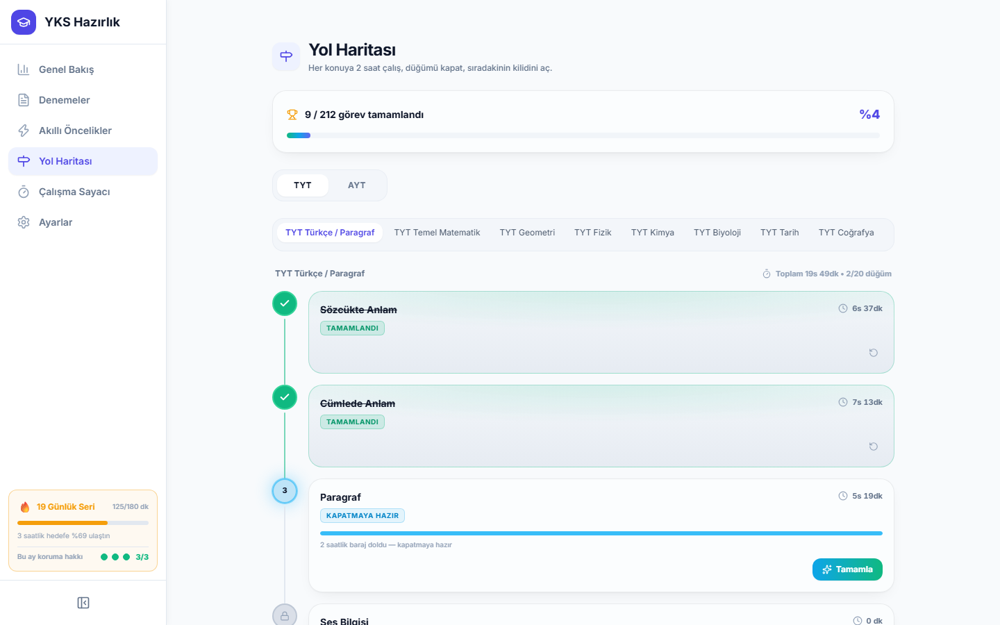

# YKS Hazırlık

**YKS'ye hazırlanan öğrenciler için deneme analizi, odak sayacı ve konu haritası. Çevrimdışı çalışır, veriler öğrencinin cihazından çıkmaz.**



**Canlı:** [yks-hazirlik.pages.dev](https://yks-hazirlik.pages.dev) · Telefonda açıp ana ekrana ekleyerek uygulama gibi kullanılabilir.

> **In English:** An offline-first PWA for students preparing for Turkey's university entrance exam (YKS). It tracks study sessions with an honest focus timer, analyzes mock exams (wrong ≠ blank under YKS scoring), and maps losses to specific topics. There is no backend; all data stays on the device, so most of the engineering went into making sure a year of a student's data can't be silently overwritten.

---

## Ne yapıyor

| | |
|---|---|
| ⏱️ **Odak Kronometresi** | Ders, konu ve çalışma türü (📖 konu anlatımı / ✏️ soru çözümü / 🎯 branş denemesi) seçilir. Soru çözerken uygulamadan çıkılırsa sayaç durur; ölçülen süre gerçekten odaklanılan süredir. |
| 📊 **Deneme Analizi** | YKS'de 4 yanlış 1 doğruyu götürür, boş ise net kaybettirmez. Analiz bu ikisini ayırır: "boşun azaldı ama yanlışın arttı, net kaybediyorsun" gibi tek denemeye bakarak görülemeyecek eğilimleri yakalar. |
| 🎯 **Konu Bazlı Kayıp** | Öğrenci her derste puanı hangi konulardan kaybettiğini tek dokunuşla işaretler. Birkaç deneme sonra aynı konudan tekrar tekrar kaybettiği ortaya çıkar. |
| ⚡ **Akıllı Öncelikler** | Konular ÖSYM soru ağırlığına göre sıralanır. Öğrencinin "bu konu tamam" dediği ama denemelerde hâlâ kaybettirdiği konular uyarı olarak çıkar. |
| 🗺️ **Yol Haritası** | 19 ders, 294 konu, MEB müfredat sırasıyla. Sayaçla çalışılan süre ilgili konuya kendiliğinden yazılır. |
| 🔥 **Çalışma Serisi** | Günlük 3 saat hedef. Kısmi günler için haftalık esneme ve aylık koruma hakları var, ama hiç çalışmayan gün ile 2 saat 55 dakika çalışılan gün aynı sayılmaz. |

<table>
  <tr>
    <td></td>
    <td></td>
  </tr>
  <tr>
    <td align="center"><sub>Net gelişimi</sub></td>
    <td align="center"><sub>Denemelerden ölçülen konu kayıpları</sub></td>
  </tr>
  <tr>
    <td></td>
    <td></td>
  </tr>
  <tr>
    <td align="center"><sub>Ders → konu → çalışma türü kırılımı</sub></td>
    <td align="center"><sub>Yol haritası</sub></td>
  </tr>
</table>

---

## Öne çıkan teknik kararlar

**Sunucu yok; bu yüzden asıl tehdit verinin kendi kodumuz tarafından ezilmesi.** Öğrencinin bir yıllık verisinin tek kopyası tarayıcının IndexedDB deposunda. Kalıcılık katmanı Zustand'ın tüm durumu her değişiklikte yazmasına dayanıyor ve bu davranışın veri kaybına dönüştüğü dört yol vardı. Bir yazma koruyucusu bunları kapatıyor:

- **Okuma hatası "yeni kullanıcı" sanılmıyor.** Eskiden depo bir kez okunamazsa karşılama ekranı açılıyor, form doldurulunca boş durum gerçek verinin üstüne yazılıyordu. Artık okuma hatası yazmayı kilitliyor ve bir kurtarma ekranı açılıyor.
- **Okuma bitmeden yazma yok.** Okuma sürerken bellekte demo durumu bulunuyor; o arada gelen bir yazma, o demo durumu gerçek verinin üstüne yazabilirdi.
- **Aynı anda yalnızca tek sekme yazıyor.** `BroadcastChannel` ile en son öne gelen sekme yazıyor, diğerleri susuyor. Geri dönen sekme önce diskten tazeleniyor, sonra yazmaya başlıyor.
- **Yazma hatası görünür.** Kayıt başarısız olursa öğrenci uyarılıyor; "kaydedildi sanıp" çalışmaya devam etmiyor.

**Sayaç zaman damgasıyla çalışıyor.** Süre `setInterval` tikleriyle sayılmıyor, başlangıç anından hesaplanıyor. Tarayıcılar arka plandaki sekmede zamanlayıcıları kıstığı için tik saymak süreyi eksik ölçüyordu. Sayaç durumu ayrıca sayfa bileşeninde değil merkezi durumda tutuluyor; böylece sekme değiştirince seans kaybolmuyor.

**Seri ileri doğru simüle ediliyor.** Aylık koruma hakkı geriye doğru yürüyerek doğru hesaplanamıyor, çünkü ayın başındaki harcamalar görülmüyor. Bu yüzden ilk çalışma gününden bugüne doğru yürünüyor. Seri hiçbir yerde saklanmıyor; her açılışta seans geçmişinden yeniden hesaplanıyor, yani bir seans silinince seri de kendiliğinden düzeliyor.

**Netler her zaman iki ondalıkla gösteriliyor.** Net, doğru eksi yanlışın dörtte biri olduğu için hep 0.25'in katı. Tek ondalığa yuvarlamak "24.3" gibi imkânsız değerler üretiyordu; hesap doğruydu ama öğrenci hesabın bozuk olduğunu düşünüyordu.

**Tavsiyeler başabaş kuralına dayanıyor.** Boş bir soruyu işaretlemenin beklenen neti `E = 1.25p − 0.25`, yani doğru şıkkı bulma olasılığı %20'yi geçince işaretlemek kârlı. Öğrencinin doğruluğu yanlış/toplam ile değil, işaretlediği soruların ne kadarının doğru olduğuyla ölçülüyor. Böylece bilgi eksiği ile risk alma alışkanlığı birbirinden ayrılıyor.

**Gün sınırı yerel saate göre.** `toISOString()` UTC kullandığı için Türkiye'de (UTC+3) gece 00:00–03:00 arasındaki çalışma önceki güne yazılıyor ve seriyi bozuyordu.

**İçe aktarma kaydı reddetmiyor, ayıklıyor.** Yedek dosyası dışarıdan gelen veri. Eskiden tek bir hatalı alan diske yazılıyor ve uygulamayı her açılışta çökertiyordu. Şimdi bozuk kayıtlar atlanıp sayılıyor, sağlam kayıtlar korunuyor. Yükleme öncesinde bir onay penceresi çıkıyor ve işlem 7 gün içinde geri alınabiliyor.

**Uygulama içi tarayıcılar algılanıyor.** LinkedIn veya Instagram'da paylaşılan link o uygulamaların kendi tarayıcısında açılıyor. Oradaki depolama geçici ve uygulama ana ekrana eklenemiyor. Bu durumda öğrenci daha karşılama formunu doldurmadan "tarayıcıda aç" uyarısı görüyor.

**Dışarıya hiçbir istek gitmiyor.** Analitik, çerez ve üçüncü taraf betik yok. Yazı tipi de Google Fonts yerine uygulamayla birlikte paketleniyor. İçerik Güvenlik Politikası (CSP) yalnızca uygulamanın kendi kaynaklarına izin veriyor; bir XSS açığı olsa bile veri dışarı gönderilemez.

Saf mantık modülleri (`streak`, `session`, `examAnalysis`, `importValidation`, `backupReminder`…) DOM'a bağlı değil; Node ile doğrudan test edilebiliyor.

---

## Teknolojiler

React 19 · Vite 8 · Tailwind CSS 3 · Zustand (persist) + localforage (IndexedDB) · framer-motion · Recharts · vite-plugin-pwa (Workbox) · Cloudflare Pages

## Yerelde çalıştırma

Node 22 veya üstü gerekir.

```bash
npm install
npm run dev      # http://localhost:5173
npm run build    # üretim derlemesi → dist/
npm run lint     # oxlint
```

## Gizlilik

Uygulama hesap istemez ve kişisel veri toplamaz. Girilen her şey yalnızca kullanıcının cihazındaki tarayıcı deposunda durur. Ayrıntılar: [Gizlilik notu](https://yks-hazirlik.pages.dev/gizlilik).

## Haklar

© 2026 Melih Tuğra Sumaz. Tüm hakları saklıdır.

Bu depo incelenmek üzere herkese açıktır; açık kaynak lisansı **taşımaz**. Kodun kopyalanması, değiştirilmesi veya başka projelerde kullanılması yazılı izin gerektirir. Ayrıntılar için [LICENSE](LICENSE) dosyasına bakın.
